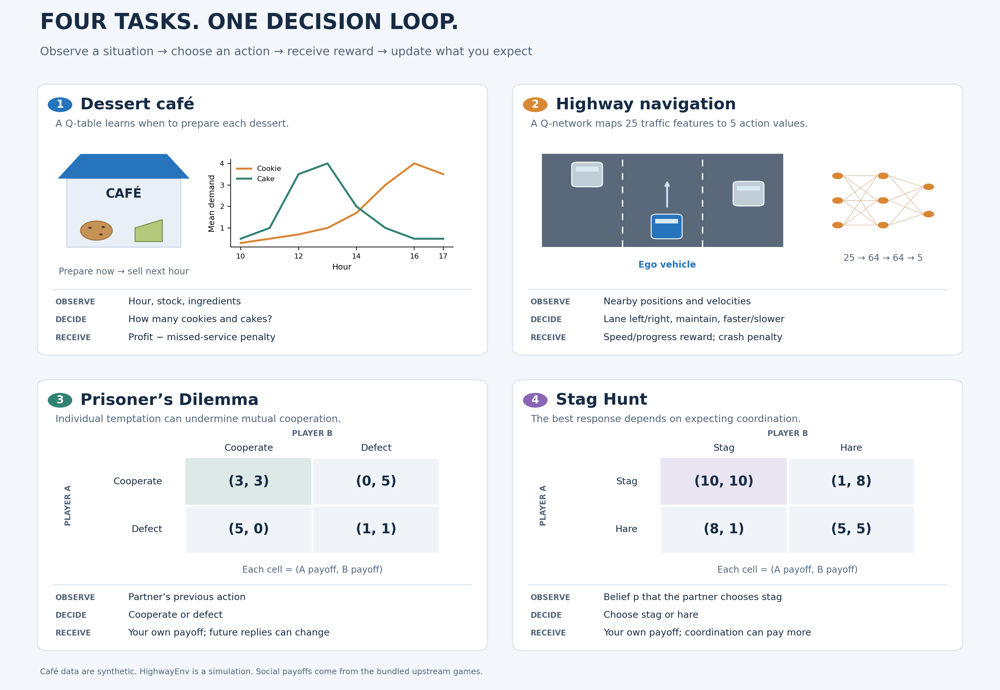

# Neuroscience-inspired AI · Chapter 3 coding lab

A local NumPy + PyTorch introduction to reinforcement learning, designed for a
55–60 minute TA video on an Apple Silicon Mac. The four tasks are a dessert café,
highway navigation, Prisoner's Dilemma, and Stag Hunt. Longer experiments are optional.



Open **[the instructor notebook](notebooks/chapter3_instructor.ipynb)** for the recording,
or **[the student workbook](notebooks/chapter3_student.ipynb)** for practice.
Both include the same array/tensor warm-up and exercise sequence. The instructor
edition contains solutions, interpretation answers, and presenter cues. The student
edition contains TODOs and checks; there is no solution switch. This private repository
contains both editions, so anyone with repository access can read the answers.

## On the prepared Desktop Mac

The project folder is `~/Desktop/Coding-session-for-Neuroscience-inspired-AI`.
Its dedicated Python 3.11 environment is in `.conda/`; your base environment is separate.

Double-click **`start_lab.command`** to open the instructor notebook in JupyterLab.
Alternatively, in Terminal:

```bash
cd ~/Desktop/Coding-session-for-Neuroscience-inspired-AI
conda activate ./.conda
python -m jupyterlab notebooks/chapter3_instructor.ipynb
```

Choose **Python (RL Chapter 3)** as the notebook kernel. The first cell prints the
active Python executable so you can verify it ends in this project's `.conda/bin/python`.
The repository is already connected to the private GitHub remote.

## Recreate the environment on another Mac

Install Conda for Apple Silicon, clone the private repository using your GitHub
credentials, then run these commands from the repository root:

```bash
conda env create --prefix ./.conda --file environment.yml
conda activate ./.conda
python -m ipykernel install --sys-prefix --name rl-chapter3 --display-name "Python (RL Chapter 3)"
python scripts/check_environment.py
python -m jupyterlab
```

The environment uses CPU PyTorch. No CUDA, MPS setup, API key, external dataset,
Google account, or native simulator window is required. Highway images are rendered
as RGB arrays inside the notebook. Installations happen outside the notebook.
The pip section explicitly uses official PyPI because the package mirror available
during setup was missing a HighwayEnv file.

`environment.yml` pins the direct dependencies. `requirements-macos-arm64.lock.txt`
records all installed pip package versions from the tested Mac. SciPy 1.14.1 was
selected after the 1.15.3 wheel failed to load on the recording machine. The environment
has been validated on this Mac; Windows and Google Colab adaptation are future work.
See [VALIDATION.md](VALIDATION.md) for the completed checks and their scope.

## How to use the student workbook

Run cells in order, complete one exercise block, then run its check cell. An
unfinished function intentionally raises `NotImplementedError`. Run All is suitable
after all TODOs are complete. Assertions explain the behavior to check; they do not
select or import instructor implementations.

| Block | What students practice |
|---|---|
| 1 | NumPy action masks, epsilon-greedy exploration, TD targets, Q updates |
| 2 | Café decisions, next-hour preparation, reward versus cash profit |
| 3 | PyTorch batch shapes, selected action values, DQN targets and Huber loss |
| 4 | A repeated-game strategy: tit-for-tat |
| 5 | Expected payoff and coordination risk in Stag Hunt |

The café buttons reveal outcomes after each decision. The Prisoner's Dilemma controls
compare strategies; the Stag Hunt slider varies the probability of partner cooperation.
Each has an ordinary-code alternative. Widgets need a live Jupyter kernel and do not
run in the static GitHub preview.

## Training and recording

The notebook's setup cell provides three budgets:

| Mode | Café days | Highway steps per method / seed | Training seeds | Use |
|---|---:|---:|---|---|
| `smoke` | 200 | 256 | 0 | Check code paths, not learning quality |
| `teaching` | 20,000 | 2,000 | 0 | Default lesson |
| `experiment` | 60,000 | 20,000 | 0, 1, 2 | Optional longer comparison |

By default the café trains live, while the highway comparison loads an actual
recorded teaching run. To train highway agents using your functions, set
`RUN_HIGHWAY_TRAINING = True` and rerun from setup. Changing the mode alone does
not override that flag. `RUN_SOCIAL_TRAINING` separately enables the optional
independent Q-learners; the core social-game strategy activities do not train agents.

The 2,000-step highway comparison uses equal interaction budgets for three tabular
resolutions and DQN, with separate development and final-evaluation seeds. It is
undertrained and uses one seed; it does not establish algorithm superiority. The
separately labelled supplied DQN checkpoint used 20,000 interactions and is never
included in the short-budget ranking. Its original metadata and local re-evaluation
are kept in `assets/`. Report crashes and speed alongside return.

Read [instructor_notes.md](instructor_notes.md) for a timed recording guide,
common mistakes, rehearsal steps, and a shorter-video option.

## Files and generated results

```text
notebooks/                 Instructor source and generated student workbook
rl_lab/                    Provided simulators, plotting, controls, exercise checks
assets/figures/             Four-task overview (PNG/SVG) and individual task panels
assets/checkpoints/         Supplied DQN and a locally trained café table
assets/reference_results/   Measured teaching runs, evaluation CSVs and provenance
vendor/                    Unchanged upstream social games, MIT license and hashes
scripts/                   Generation, environment checks and notebook verification
tests/                     Learning, accounting, rendering and exercise checks
results/                   New runs, figures, GIFs and models (Git-ignored)
```

Each notebook run creates a new results directory and records whether comparison
data were freshly trained or cached. `.npz` checkpoints are loaded with
`allow_pickle=False`. Notebook paths are relative to the checkout, so opening from
the repository root or `notebooks/` works. The supplied lecture PDFs are not copied.

## Maintain and verify

Edit **only `notebooks/chapter3_instructor.ipynb`** for shared teaching content.
Exercise cells have `student_source` metadata containing the intended TODO scaffold;
presenter/answer cells are tagged `instructor-only`. After editing, regenerate the
student workbook. If you change an exercise interface, also update its scaffold
metadata and check. Do not distribute a student workbook with saved answer outputs.

```bash
python scripts/build_student.py
python scripts/check_environment.py
python -m pytest -q
python scripts/verify_notebooks.py --mode smoke
```

The last command executes the instructor notebook and a temporarily completed
student notebook in separate fresh kernels, including short highway training.
It injects instructor exercise definitions **in memory for verification only**;
it never writes answers into the distributed student notebook. The temporary student
check skips widget display to avoid an nbclient widget-state issue; pytest exercises
the control callbacks, and the instructor check renders all three widget views. Executed verification
copies and the report go to ignored `results/verification/`.

To rehearse the default presentation and refresh the instructor's saved outputs:

```bash
python scripts/verify_notebooks.py --mode teaching --cached-highway --save-instructor
python scripts/build_student.py
```

To regenerate visual assets and the measured reference runs:

```bash
python scripts/generate_figures.py
python scripts/generate_reference_results.py
```

The reference-generation command retrains the café for 60,000 days, trains the four
highway agents for 2,000 interactions each, and evaluates the supplied 20,000-step DQN.
It replaces bundled reference files, so inspect the resulting changes before committing.

## Sources

The café is a synthetic teaching environment migrated from the supplied TA notebook.
Game source is unchanged at commit `f42dfe8516f5d1290d9076e2563e99f2770d46bf`;
see [vendor/PROVENANCE.json](vendor/PROVENANCE.json) and [vendor/LICENSE](vendor/LICENSE).
See [assets/PROVENANCE.json](assets/PROVENANCE.json) for the source notebook checksum.

- [Gymnasium environment API](https://gymnasium.farama.org/api/env/) and
  [termination versus truncation](https://gymnasium.farama.org/tutorials/gymnasium_basics/handling_time_limits/)
- [HighwayEnv documentation](https://highway-env.farama.org/)
- [PyTorch DQN tutorial](https://docs.pytorch.org/tutorials/intermediate/reinforcement_q_learning.html)
- [PettingZoo-Dilemmas upstream](https://github.com/mrochk/pettingzoo-dilemmas)
- [Conda environments](https://docs.conda.io/projects/conda/en/stable/user-guide/tasks/manage-environments.html)
